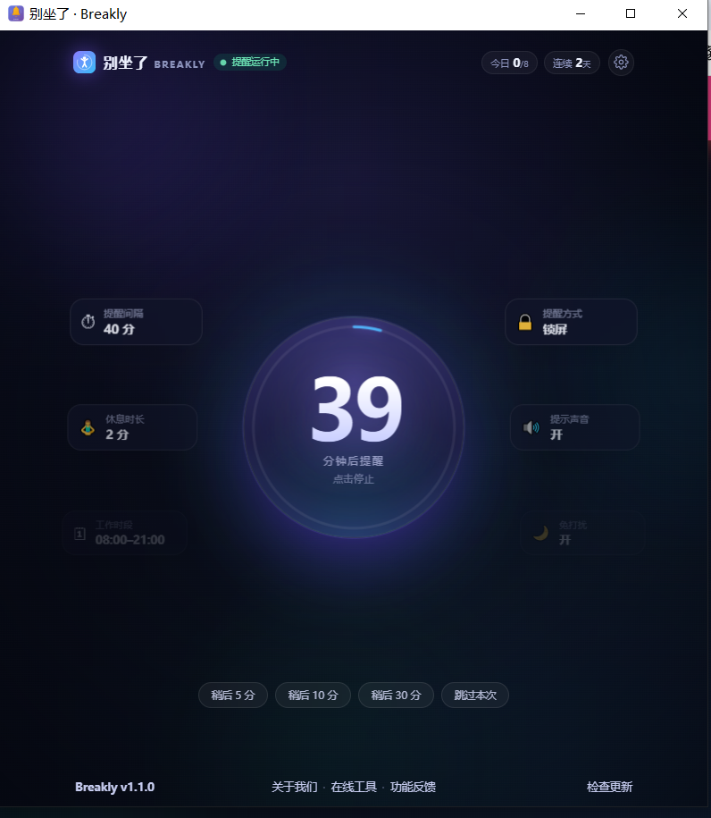
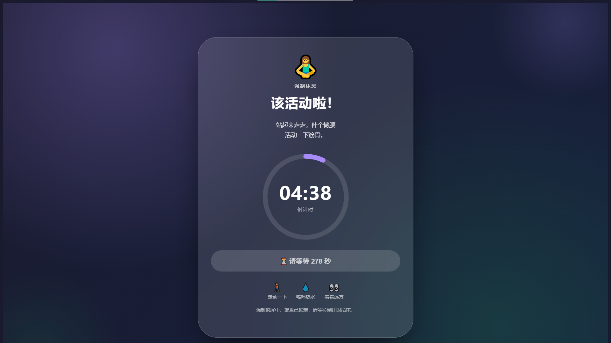

<h1 align="center">别坐了 (Breakly)</h1>
<h2 align="center">定时提醒 · 拒绝久坐</h2>

<p align="center">
<strong>基于 Tauri 2 + Vue 3 + TypeScript 的健康提醒桌面应用，提供全屏提醒遮罩、全局键盘拦截、系统通知与自动更新。</strong>
</p>

<p align="center">
  <a href="https://github.com/neopen/break-reminder/releases"></a>
  <a href="https://github.com/neopen/break-reminder/releases"></a>
  <a href="LICENSE"></a>
  
  
  <a href="https://breakly.helpoke.com"></a>
</p>

## 核心能力

- **强制提醒遮罩**：全屏、无边框、置顶、跳过任务栏，倒计时结束自动关闭
- **全局键盘拦截**：Windows 低层键盘钩子，音量键放行，遮罩关闭即恢复
- **声音提示**：WebView 无用户手势自动播放（Windows 通过 WebView2 启动参数启用）
- **系统通知**：安装版可注册 Windows 通知（便携版受系统限制不显示）
- **托盘与单实例**：托盘菜单、开机自启、二次启动聚焦已有窗口
- **自动更新**：GitHub Release + `tauri-plugin-updater`，更新包签名校验

## 界面预览

主界面



提醒界面



## 安装使用

### 方式一：在线体验

访问 [定时提醒 - 拒绝久坐](https://breakly.helpoke.com/)，直接用浏览器打开即可使用。

> 建议使用 Chrome/Edge/Safari 等现代浏览器，可获得最佳体验。

### 方式二：安装桌面应用（推荐）

下载安装软件：[GitHub Releases](https://github.com/neopen/break-reminder/releases) 最新稳定版（1.0 之前的版本体积较大，建议选择最新版安装）。

支持平台：Windows（通过）、macOS（尚未测试）、Linux（尚未测试）

## 使用说明

### 基本设置

| 设置项   | 说明                               | 范围                   | 默认值  |
| -------- | ---------------------------------- | ---------------------- | ------- |
| 开始时间 | 每日提醒开始时间                   | 00:00 - 23:59          | 08:00   |
| 结束时间 | 每日提醒结束时间                   | 00:00 - 23:59          | 18:00   |
| 提醒频率 | 两次提醒之间的间隔                 | 10 ~ 300 分钟（步长5） | 40 分钟 |
| 声音提示 | 时间到支持声音提醒                 | 开/关                  | 开      |
| 桌面通知 | 系统级通知提醒（需要开启系统权限） | 开/关                  | 开      |
| 锁屏通知 | 全屏锁定通知                       | 开/关                  | 关      |
| 锁屏时长 | 每次提醒的锁屏时间                 | 1 ~ 30 分钟            | 5 分钟  |
| 强制锁屏 | 开启后无法提前关闭弹框             | 开/关                  | 关      |

> 开启**Windows 通知设置**：
>
> 1. 打开 Windows 设置 → 系统 → 通知和操作
> 2. 确保"获取来自应用和其他发送者的通知"已开启
> 3. 在列表中找到您的应用，确保通知已开启

### 统计卡片说明

| 指标       | 说明                                                              |
| ---------- | ----------------------------------------------------------------- |
| 今日活动   | 今日完成的活动提醒次数                                            |
| 连续打卡   | 连续完成活动的天数                                                |
| 本周完成率 | 本周活动次数 / 本周目标次数 × 100%（目标：每天 8 次，每周 40 次） |

### 运行状态

| 状态   | 显示                       | 说明                        |
| ------ | -------------------------- | --------------------------- |
| 未启动 | 暂停按钮置灰，启动按钮可点 | 可自由修改配置              |
| 运行中 | 启动按钮置灰，暂停按钮可点 | 同时下方显示下次提醒时间    |
| 锁屏中 | 全屏弹框                   | 强制/非强制模式，倒计时显示 |
| 锁屏中 | 桌面通知                   | 消息通知，5秒后自动关闭     |

## 技术栈

| 层       | 技术                                                       |
| -------- | ---------------------------------------------------------- |
| 桌面容器 | Tauri 2（Rust）                                            |
| 前端     | Vue 3 + TypeScript + Vite                                  |
| UI       | 设计令牌 + 组件化 CSS，双入口（主窗口 / 锁屏）             |
| 原生能力 | 托盘、单实例、自启、通知、更新插件 + 自研 Windows 键盘钩子 |
| 质量     | vue-tsc、ESLint、Prettier、rustfmt、Clippy                 |
| 构建发布 | GitHub Actions，三平台矩阵，NSIS / DMG / AppImage / DEB    |

## 体积与资源

| 构建                                          | 体积           |
| --------------------------------------------- | -------------- |
| Windows `Breakly-Setup.exe`（未签名测试构建） | **3.3 MB**     |
| Windows 便携 exe                              | 14 MB          |
| Electron 旧版安装包 / 安装后                  | 97 MB / 306 MB |

安装后实际占用与空载内存待 Windows 正式包实测后补充。

## 快速开始

### 前置依赖

- Node.js 22+
- Rust stable（`rust-toolchain.toml` 会安装 rustfmt / clippy）
- 平台构建工具
  - Windows：Visual Studio Build Tools（C++ 桌面开发）+ WebView2 Runtime
  - macOS：Xcode Command Line Tools
  - Linux：`libwebkit2gtk-4.1-dev`、`libayatana-appindicator3-dev`、`librsvg2-dev`、`patchelf`

### 开发与构建

```bash
npm install
npm run tauri dev      # 启动 Tauri 开发窗口
npm run tauri build    # 构建当前平台安装包
```

仅调试前端：

```bash
npm run dev            # 浏览器预览，原生能力禁用
npm run typecheck
npm run lint
npm run build
```

## 常用命令

| 命令                              | 作用                      |
| --------------------------------- | ------------------------- |
| `npm run tauri dev`               | 启动桌面开发窗口          |
| `npm run tauri build`             | 构建当前平台安装包        |
| `npm run dev`                     | 仅启动 Vite（浏览器预览） |
| `npm run build`                   | 类型检查 + 前端生产构建   |
| `npm run typecheck`               | `vue-tsc` 类型检查        |
| `npm run lint` / `lint:fix`       | ESLint                    |
| `npm run format` / `format:check` | Prettier                  |
| `npm run version:sync`            | 同步版本到 Tauri / Cargo  |
| `npm run version:check`           | 校验三处版本一致          |
| `npm run audio:generate`          | 重新生成提醒音效          |


## 已知限制

- 全局键盘拦截目前仅实现 Windows；macOS（CGEventTap）与 Linux（X11 grab）为后续阶段
- Windows 系统通知仅对已安装应用生效
- `Ctrl+Alt+Del`、`Win+L` 属于系统安全序列，普通桌面应用无法拦截
- macOS 自动更新要求应用完成签名与公证


## 许可证

[MIT](LICENSE) © 2026 neopen
